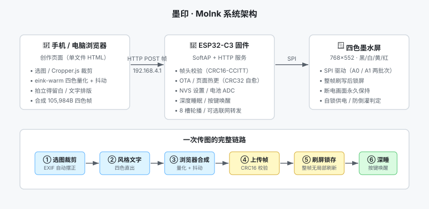
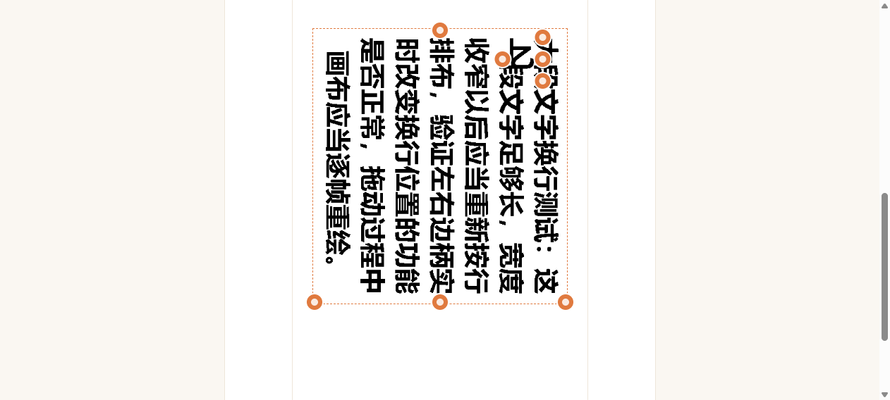

# 墨印 · MoInk 新手入门教程

> 目标：从零开始，把你的第一张照片显示在墨水屏上。
> 全程约 40 分钟（含工具链安装约 20 分钟）。**只想先跑起来**的话，跳到 [4. 刷机](#4-给设备刷机) 用现成刷机包，5 分钟能出画面。
>
> 对应版本：**R1.3.6**（接口 api = 2）。有出入以 [CHANGELOG](CHANGELOG.md) 最新条目为准。

## 目录

1. [准备硬件](#1-准备硬件)
2. [安装开发环境](#2-安装开发环境)
3. [编译固件](#3-编译固件)
4. [给设备刷机](#4-给设备刷机)
5. [连接热点](#5-连接热点)
6. [上传第一张照片](#6-上传第一张照片)
7. [轮播图库](#7-轮播图库)
8. [设备设置逐项说明](#8-设备设置逐项说明)
9. [升级固件与控制页](#9-升级固件与控制页)
10. [供电与电池安全](#10-供电与电池安全)
11. [开发：改页面与改固件](#11-开发改页面与改固件)
12. [常见问题](#12-常见问题)

---

## 系统总览

先看分工——**所有图像处理都在浏览器里完成，设备只负责收帧、刷屏、睡觉**：



一次传图的链路：手机选图裁剪 → 风格化 + 文字 → 浏览器合成 105,984 字节的四色帧 → 上传到 `192.168.4.1` → 设备校验后整屏刷写 → 空闲到点自动深睡。

---

## 1. 准备硬件

| 部件 | 说明 |
|------|------|
| ESP32-C3 SUPERMINI 开发板 ×1 | 必须是 **C3**（引脚与 ADC 通道按 C3 写死），S3 / C6 不兼容 |
| 768×552 四色墨水屏 ×1 | 华为拆机屏（JD79665AA），黑/白/黄/红，2bpp |
| USB 数据线 ×1 | 板载 USB-Serial/JTAG，普通能传数据的 Type-C 线即可（**不是纯充电线**） |
| 杜邦线 / FPC 排线 | 按下面任一种接线方式 |
| （可选）锂电池 + 充电模块 | 接 ADC 分压（1M:1M）可显示电量 |
| （可选）开机自锁电路 | 一只 MOS（如 AO3401）+ 按键，栅极接 GPIO2 |

### 1.1 接线（页面里选「GPIO 设置 → 接法」）

| 信号 | 默认档（杜邦线） | 排线档（FPC） | 整合板档 |
|------|------------------|---------------|----------|
| SCK | GPIO4 | GPIO7 | GPIO4 |
| MOSI(DIN) | GPIO6 | GPIO10 | GPIO3 |
| CS | GPIO7 | GPIO6 | GPIO5 |
| DC | GPIO1 | GPIO5 | GPIO6 |
| RST | GPIO3 | GPIO4 | GPIO7 |
| BUSY | GPIO10 | GPIO3 | GPIO10 |
| 唤醒键 | GPIO5 | GPIO1 | GPIO1 |
| 电池 ADC | GPIO0 | GPIO0 | GPIO0 |
| 自锁（固定） | GPIO2 | GPIO2 | GPIO2 |
| 屏幕 VCC / GND | 3.3V / GND | 3.3V / GND | 3.3V / GND |

- 三档都不合适就用「自定义」：逐个下拉选 IO，选项里已自动排除被其它项占用、超出白名单（仅 GPIO0..10）、以及自锁脚 GPIO2。
- 电池 ADC 只能选 GPIO0–4（C3 的 ADC1 固定绑这几脚），唤醒键只能选 GPIO0–5（只有 RTC 域这几个脚能在深睡时唤醒）。
- **改引脚必须重启才生效**（SPI 总线与 ADC 通道只在开机时初始化）。

### 1.2 按键

按键一端接唤醒脚、另一端接 GND，低电平有效：

| 操作 | 效果 |
|------|------|
| 单击 | 唤醒 / 重置空闲计时（**不切图**） |
| 双击 | 切到下一张轮播图 |
| 长按 20 秒 | 恢复出厂设置（引脚配置错了也能靠它救回来） |

### 1.3 电池与自锁

- 电池经 **1M:1M 分压**接 ADC 脚，比值 ×2.0。ADC 端建议并联 **100 nF** 到地（1 M 是高阻源，不并电容读数会偏低、抖动大）。
- GPIO2 是**自锁脚**：接 MOS 栅极，开机后固件拉高维持供电，关机时拉低断电。没有自锁电路也能用，只是「关机」会退化成「深睡」。
- ⚠️ **接了电池和外接 USB 的板子，先读 [第 10 节](#10-供电与电池安全)**：老版排线在旧固件下插 USB 会把 5 V 倒灌进电池。R1.3.6 已修，但必须在页面里如实选择排线版本。

---

## 2. 安装开发环境

> 只想刷现成固件？**跳过这一节和下一节**，直接看 [4. 刷机](#4-给设备刷机)。

### 2.1 安装 Python（3.9+）

从 [python.org](https://www.python.org/downloads/) 下载安装，安装时勾选 **Add Python to PATH**。

### 2.2 安装 PlatformIO

```bash
pip install platformio
python -m platformio --version
```

> 💡 也可以用 VS Code + PlatformIO 插件，图形界面更友好；本教程用命令行演示。

### 2.3 克隆项目

```bash
git clone <仓库地址> moink
cd moink
```

---

## 3. 编译固件

```bash
python -m platformio run -e moink
```

成功标志：日志末尾出现 `RAM:` / `Flash:` 两行且无 error；产物在 `.pio/build/moink/firmware.bin`，同时生成 `firmware.elf`。

参考占用（R1.3.6）：**RAM 46,764 B（14.3%）/ Flash 1,045,392 B（79.8%）**，0 告警。

### 3.1 Windows 中文系统的两个坑

**坑一：分区表解码报错（`UnicodeDecodeError`）** —— 分区表含 UTF-8 中文注释：

```powershell
# PowerShell
$env:PYTHONUTF8="1"
python -m platformio run -e moink
```

```bash
# Linux / macOS / Git Bash
PYTHONUTF8=1 python -m platformio run -e moink
```

**坑二：编译突然卡住不动 / 收尾一堆 `SystemExit: 1`** —— SCons 在 Windows 上每编一个文件都要建删临时文件，被沙箱或安全软件拦截就会卡死。用 WorkBuddy 等托管环境时加：

```bash
CODEBUDDY_SAFE_DELETE_ENABLED=0 PYTHONUTF8=1 python -m platformio run -e moink
```

判据：日志里出现大量 `SAFE_DELETE`，或日志时间戳停在几分钟前不动。

### 3.2 页面固化的三件套（改页面必看）

固件里内嵌了一份创作页（`src/index_html.h`）。**只改 `page/index.html` 不重新生成，编出来还是旧页面**（线索：`Flash:` 数字一点没变）。正确顺序：

```bash
node tools/smoke_page.js          # 页面结构与契约门禁
python tools/make_index_header.py # 页面 → src/index_html.h（会断言版本号一致）
python -m platformio run -e moink
```

改固件逻辑时再加两道：

```bash
python tools/check_frame.py       # 帧协议 + 打包布局
python tools/check_algo.py        # 图像算法逐像素一致性（必须 RESULT: MATCH）
```

---

## 4. 给设备刷机

### 方式 A：一键刷机包（推荐新手，免编译）

1. 到 [Releases](https://github.com/atunverse/moink/releases) 下载 `MoInk-FlashKit-R1.3.6.zip` 并解压
2. 双击 `MoInk一键刷机.bat`（没装 Python 会引导自动安装）
3. 等它自动选串口、自动刷写（约 1~2 分钟），看到 `[OK]` 即成功

脚本只认带 VID 的真实 USB 串口，蓝牙之类的虚拟串口会自动跳过。

### 方式 B：命令行刷机

```bash
python tools/flash_moink.py
```

（等价于对 `moink_R1.3.6_merged.bin` 做 0x0 整包写入。）

### 刷机成功标志

- 屏幕出现开机画面（白闪几次 → 画面稳定）
- 手机 WiFi 列表出现热点 **`MoInk-XXXX`**（XXXX = 设备 MAC 后 2 字节）

> ⚠️ **不要用浏览器网页烧录器**：本板是 C3 原生 USB-JTAG，WebSerial 会卡在 `Stub running...`，一个字节都写不进去。卡住了就拔插一次 USB，改用命令行方式。

---

## 5. 连接热点

1. 手机打开 WiFi，连接 **`MoInk-XXXX`**（默认无密码）
2. 多数手机会**自动弹出**创作页（captive portal）；没弹就用浏览器访问：

   ```
   http://192.168.4.1
   ```

3. 右上角连接状态显示正常即成功



页面布局：**手机单列**（控制区在上、预览区在下）；**桌面双栏**（左边控制、右边预览固定）。顶部可在「拍立得 / 便签」两种模式间切换。

> 部分手机在连上热点后会因为「没有互联网」自动切回移动数据，导致页面打不开或上传失败。处理：WiFi 高级设置里关掉「自动切换网络」，或上传时临时关掉移动数据。

---

## 6. 上传第一张照片

### 6.1 拍立得模式（默认）

1. **① 选图**：点「选择图片」，从相册挑一张（竖版构图效果最好，页面默认竖屏）。也可以拖入或直接粘贴。
2. **② 裁剪调整**：拖动裁剪框构图；双指捏合缩放、拖动移动图片；角度接近 90° 整数倍会自动贴合。手机直拍的照片会**按 EXIF 自动摆正**。
3. **③ 风格与文字**（都可跳过）：
   - **风格预设**：自然暖调（推荐人像/食物）、全面暖色、纯灰度、原色直出
   - **色彩强度**：0~100，默认 60
   - **高级图像设置**：抖动算法（Floyd-Steinberg / Stucki / Jarvis / Burkes / Sierra Lite / Atkinson / Bayer 8×8 / 无抖动）、色域（标准 / 线性光 / sRGB）、自动色阶，以及各算法参数滑块
   - **留白**（拍立得白边）：四条边分别勾选，默认上下 200 px、左右 100 px
   - **文字**：勾「添加文字」→ 输入 → 点「＋ 添加」上屏。右下圆点改大小、右上转方向、左下改宽窄、左上红点删除；可设字体、颜色（黑/白/黄/红）、描边粗细与描边色、文字底色
4. **④ 上传**：点「**上传并刷新屏幕**」，等提示「屏幕刷新中…」

四色屏需要多轮振荡显色，白闪几次是**正常现象**，几秒后画面稳定。整屏刷新耗时取决于画面内容（纯色最快，复杂照片较慢）。

> 「上传并刷新屏幕」= **只换画面，不占轮播槽位**（临时换图不磨损 flash）。想把图存进设备离线轮播，见下一节。

### 6.2 便签模式

顶部切到「便签」：直接输入文字 → 调字体 / 大小 / 颜色 / 描边 / 文字底色 / 屏幕底色 → 上传。适合留言条、待办、门牌。

---

## 7. 轮播图库

设备最多存 **8 张**图，断电不丢，可以离线循环播放。

- **上传到图库**：占一个槽位（满 8 张会提示先删除）
- **双击设备按键**：切到下一张
- **单击按键**：只唤醒，不切图
- 手机端图库是彩色缩略图网格：点缩略图看大图，点 × 删除，或「清空轮播」
- 大图预览里可以把某张「**显示到屏幕**」，不必重新上传

> 图库槽位用 NVS 位图管理，删除是 O(1) 的（毫秒级、几乎不磨损 flash），删掉的槽位会被新图优先回填。

---

## 8. 设备设置逐项说明

主页右上角 **⚙** 进入。设置分六个折叠区：

### 设备信息
版本（当前生效的控制页）/ 接口（帧契约号，当前 2）/ 屏幕 / 当前热点 / 空闲内存 / 电池 / 在线设备 / 本次唤醒来源。

### 电源管理
| 项 | 说明 |
|----|------|
| 超时 | 1 / 3 / 5 分钟，或「不超时」 |
| 超时动作 | **休眠**（可被按键/定时唤醒）或 **关机（断电）**（需自锁电路，非自锁板会退化为休眠） |
| 排线版本 | 仅「接法 = 排线」时出现：勾选 = 新排线（CH213K 阻断、ADC 接 VSYS），**不做 USB 插入检测**；不勾 = 老排线，**电池供电不允许休眠** |
| 自动唤醒 | 关闭 / 1 小时 / 12 小时 / 1 天（醒来开热点等人传图约 3 分钟） |
| 唤醒后切图 | 定时唤醒后自动切下一张 |

### 热点设置
热点名（留空 = `MoInk-XXXX`）、密码（留空 = 开放）、**WiFi 功率**（高 18dBm / 中 10dBm / 低 8.5dBm 默认）。连不上或传输不稳就调高一档。

### 联网（上游 WiFi）
- **联网**：设备去连路由器（默认关闭）
- **转发**：连本设备热点的手机也能上网（NAPT）
- 最多记 **8 个**网络，开机/唤醒按「上次连上的优先」依次尝试，全失败每 15 秒重试
- 「扫描附近 WiFi」可列出周围网络（**阻塞 1~2 秒**，只手动点，页面不会自动轮询）
- 连不上只影响外网：热点、传图、轮播、休眠全都不受影响

### 屏幕设置
屏幕批次 **A0 / A1**（不同批次的拆机屏驱动不同，选错会花屏或全黑）、左右镜像。

### GPIO 设置
四档接法（默认 / 排线 / 整合板 / 自定义），见 [1.1](#11-接线页面里选gpio-设置--接法)。改完点「保存并重启」；改错导致不亮屏时，按住唤醒键 20 秒恢复出厂。

### 系统维护与升级
清理残影（黑白闪刷 2 次）、上传并升级、恢复内置页面、恢复出厂（两步确认）。

---

## 9. 升级固件与控制页

**只有一个入口**：设置 → 系统维护与升级 → ① 升级。选文件、点上传即可，**不需要判断**升的是固件还是页面 —— 设备按内容自动识别：

| 上传的文件 | 设备行为 | 耗时 |
|------------|----------|------|
| `moink_R1.3.6_app.bin`（固件） | 写入备用分区 → 校验 → 切槽 → 顺带更新控制页 → 自动重启 | 约 1 分钟 |
| `page-R1.3.6.html`（控制页） | CRC32 校验 → 只替换控制页 → **不重启**，刷新浏览器即可 | 数秒 |

- 控制页热更在独立 web 分区，**校验失败自动回退内嵌页**，不会变砖；也可手动点「恢复内置页面」。
- 固件走双分区 OTA，刷失败可回滚；**升级不重置用户设置**（热点、GPIO、电源、联网等全部保留）。
- 版本号只有一套：固件与控制页共用。页面被单独热更过时，「版本」显示的是当前生效的控制页版本；低于固件版本会标红提示重新上传固件。
- 从 R1.2.0 起分区表未变，可直接网页 OTA；**R1.1.x 及更早必须线刷整包**。

---

## 10. 供电与电池安全

### 10.1 老排线的问题

老版 FPC 排线上，电池经两只背靠背 AO3401 接到 VSYS，栅极由 GPIO2 驱动。旧固件**上电就无条件自锁**，于是插 USB 时 5 V 会顺着自锁通路直接压在电芯 / 充电管理芯片的 BAT 脚上：压差约 1.1 V、回路约 0.25 Ω ⇒ **倒灌 3~4 A 且无 CC/CV**，有发热、鼓包隐患。

### 10.2 R1.3.6 怎么解决（纯软件，零改板）

| 场景 | 固件行为 |
|------|----------|
| 冷启动 | **只判断按键是否被按住**。电池到 VSYS 的唯一通路就是按住按键；USB 上电没人按键 ⇒ 判为 USB 供电，**不自锁** |
| 运行中（已自锁） | 每 200 ms 采一次 ADC，**连续 3 次 > 4500 mV** 才释放自锁（约 600 ms 内切断电池） |
| 未自锁（USB 供电） | 不采样、不轮询 |
| 新排线（页面勾选） | 整段跳过检测：CH213K 已反向阻断，ADC 接 VSYS，照旧检测会把电池误切（拔线就断电） |
| 老排线 + 电池 + 超时 | 一律按「关机」处理，**不允许休眠**（睡着的芯片没有任何手段发现 USB 插入） |
| 复位（保存并重启 / OTA / WDT） | 读 RTC 记忆恢复自锁状态，不会「重启即自锁」 |
| 深睡 | 按当前状态锁电平；USB 供电时锁「低」= 电池隔离 |

### 10.3 行为代价（必须知道）

- **USB 供电时设备不持有电池 ⇒ 拔线即断电**，需要按一下开机键。
- 开机键要按到开机完成（约 0.3 秒）；按太短会「按了没反应」，这是安全方向的退化。
- 接法选错时电池开不了机：先插 USB 进页面把接法选对，再拔线用电池。
- 老排线用电池时不再休眠，定时唤醒随之失效。

### 10.4 硬件侧建议（新排线）

把一只 AO3401 换成 **CH213K 理想二极管**做反向阻断；充电走独立 **4057**（VSYS → 电池）；ADC 分压改接 **VSYS**。软硬兼施后插拔 USB 完全无感，休眠也能恢复。

---

## 11. 开发：改页面与改固件

### 改页面（最常见的迭代方式）

1. 编辑 `page/index.html`（单文件，含全部 CSS/JS；本地用浏览器打开可离线预览，但上传功能需要连设备）
2. 改 `<meta name="moink-page-version">` 与 `src/version.h` 的 `MOINK_VERSION`（两者必须一致）
3. 跑门禁 + 固化 + 编译：

   ```bash
   node tools/smoke_page.js
   python tools/make_index_header.py
   python -m platformio run -e moink
   ```

4. 也可以不刷固件，直接把 `page/index.html` 改名为 `page-R1.3.6.html` 在设备里**热更**（数秒生效）。验证稳定后再固化进固件。

### 改固件

- 通电契约、屏驱动、分区表等硬约束先读 [CONTRACT.md](CONTRACT.md)，改完必须同步更新文档与门禁断言
- 版本号推进：破坏性变更主版本 +1、功能批次版本 +1、修复批第三位 +1；只有帧契约变化才动 `MOINK_API_VERSION`
- 任何合入都要在 [CHANGELOG.md](CHANGELOG.md) 加条目（最新在上）

---

## 12. 常见问题

**Q：上传时提示「网络错误：请确认已连接设备热点」？**
手机可能自动切回了移动数据/家庭 WiFi。连接 MoInk 热点后关掉「自动切换网络」，或上传时临时关移动数据。

**Q：屏幕有残影 / 底色发灰？**
设置 → 系统维护 → **清理残影**（黑白全屏闪刷约 40~60 秒）。

**Q：刷机后不出热点、按键无反应？**
大概率网页烧录器卡在 stub 里。拔插一次 USB，改用 `tools/flash_moink.py` 或刷机包。电脑识别不到串口时，注意跳过无 VID 的虚拟串口（蓝牙串行口）。

**Q：黄色/红色显示不对、屏幕全黑或花屏？**
先确认「屏幕设置」的 **A0/A1 批次**选对，再确认 **GPIO 接法**与实物一致。色码映射已按实测锁定（0x02=黄、0x03=红），不要自行改驱动。详见 [CONTRACT.md](CONTRACT.md)。

**Q：改 GPIO 后屏不亮了？**
引脚只在开机时初始化：先「保存并重启」。仍不亮就按住唤醒键 20 秒恢复出厂。

**Q：换了电池或改了分压电阻，电量不准？**
固件按 ×2.0（`BAT_DIV_NUM/DEN = 200/100`）换算，1M:1M 与 100k:100k 比值相同，无需改固件。误差大需按实测重标 `src/power.c` 的 `BAT_FULLSCALE_MV`（当前 3100 mV）。新排线 ADC 接 VSYS，插着 USB 时读到接近 5 V 是正常的（那是母线不是电芯）。

**Q：插 USB 后拔线就断电，是不是坏了？**
不是。R1.3.6 起 USB 供电时刻意不持有电池（防倒灌），按一下开机键即可。

**Q：电池能用多久？**
传图完成后设备进入深睡，电流 μA 级，墨水屏断电保持画面。具体续航取决于电池容量与传图频次，暂无系统实测数据。**注意**：老排线在 R1.3.6 下电池供电不休眠，需要靠「关机」省电。

---

*教程对应版本：R1.3.6 · api 2。更新记录见 [CHANGELOG](CHANGELOG.md)。*
