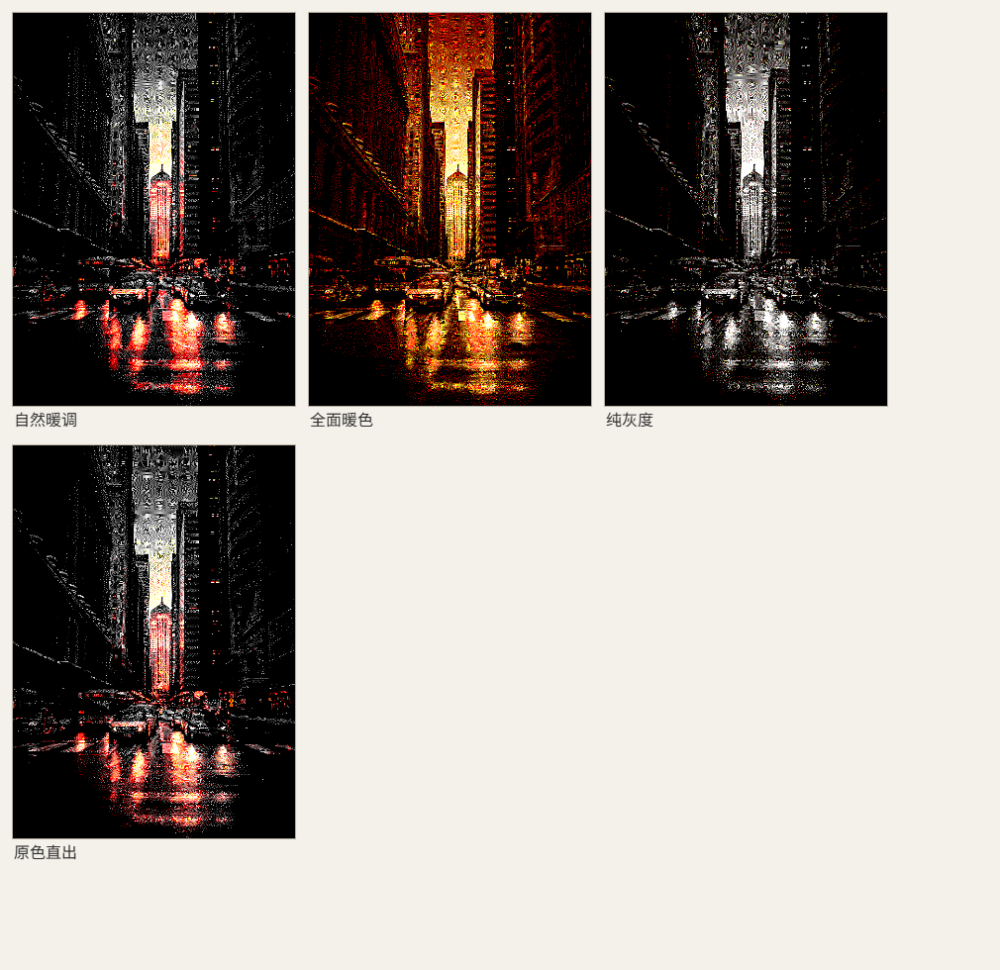
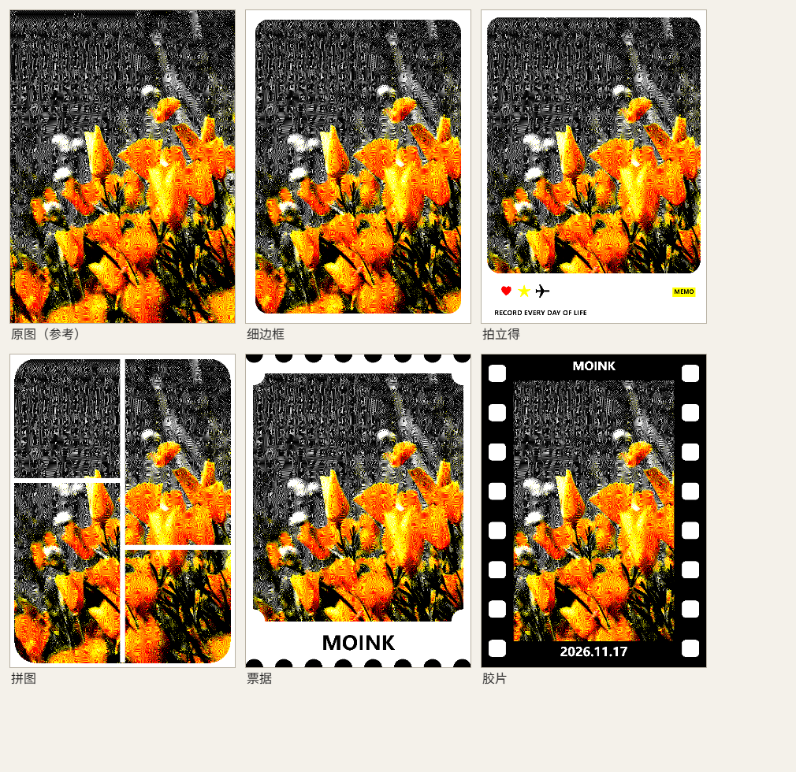
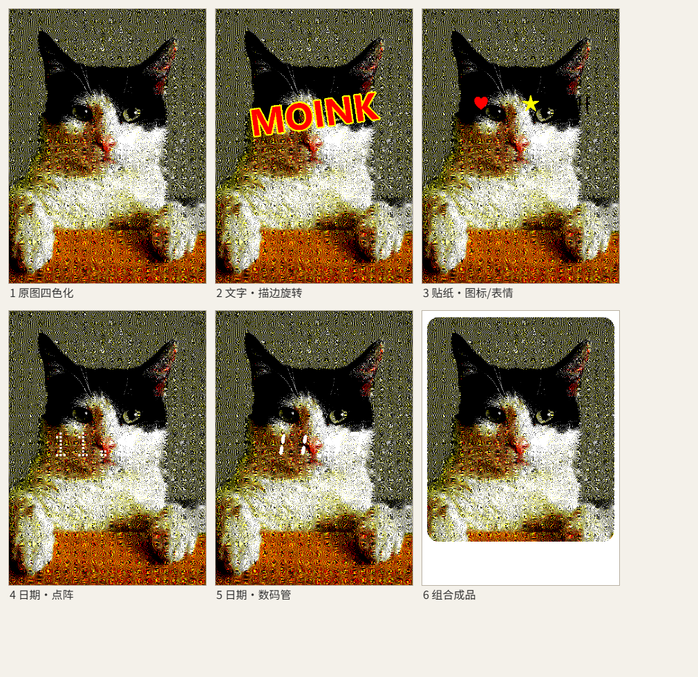
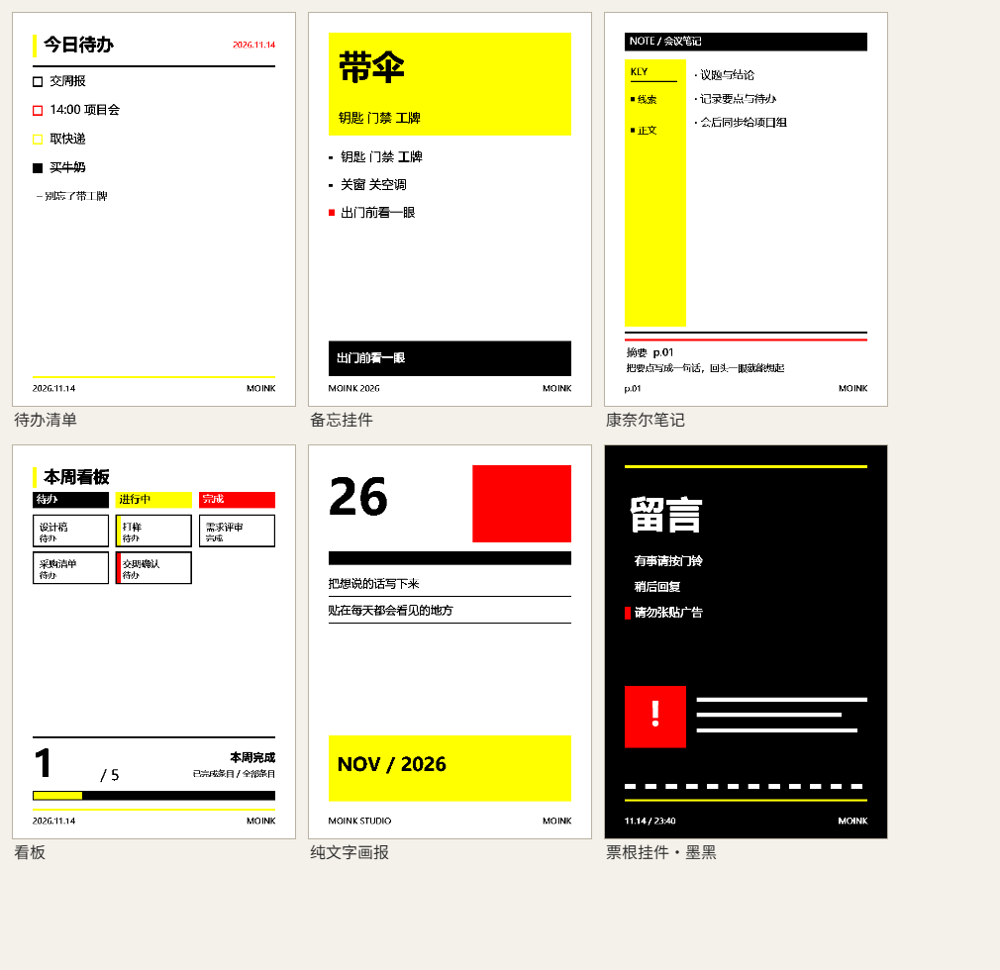

# 墨印 MoInk R1.4.0 操作说明书

> 适用版本：R1.4.0　|　屏幕：768×552 黑白黄红四色电子墨水屏
> 配套：[更新说明](更新说明-R1.4.0.md) · [入门教程](入门教程.md) · [CHANGELOG](CHANGELOG.md)

---

## 目录

1. [开机与连接](#1-开机与连接)
2. [控制页总览](#2-控制页总览)
3. [做一张照片：构图 / 调色 / 特效 / 保存](#3-做一张照片)
4. [便签模式](#4-便签模式)
5. [设备按键与轮播图库](#5-设备按键与轮播图库)
6. [设备设置](#6-设备设置)
7. [升级与刷机](#7-升级与刷机)
8. [常见问题](#8-常见问题)

---

## 1. 开机与连接

1. 装好电池 / 接上电源，按一下设备按键开机（按一下松手即可，不用一直按住）。
2. 手机打开 WiFi，连接设备热点 **`MoInk-XXXX`**（默认开放、无密码）。
3. 浏览器打开 **`http://192.168.4.1`**，会看到控制页；若已接入路由器，也可用门户引导页进入。

> 控制页**随固件发布**，不需要也不再单独更新页面文件。

## 2. 控制页总览

页面从上到下：**顶栏**（品牌 / 连接状态 / 设置齿轮）→ **模式行**（拍立得 / 便签）→ **相纸画布** → **底栏四工具**。

| 区域 | 作用 |
|------|------|
| 顶栏设置齿轮 | 进「设备设置」（WiFi / GPIO / 屏幕 / 电源 / 更新恢复） |
| 模式行 | 拍立得（图为主）↔ 便签（字为主），底栏工具随模式切换 |
| 相纸画布 | 768×552 等比预览，所见即所得；单指拖动对象、双指缩放 |
| 底栏 | 拍立得模式：`构图 · 调色 · 特效 · 保存`；便签模式：`内容 · 版式 · 配色 · 保存` |

点底栏任一工具从下方弹出面板，**相纸自动缩小但保持完整可见**；再点同一工具或下拉面板顶部抓手即可收起。

## 3. 做一张照片

### 3.1 上传
在「保存 → 图槽」或入口处选图上传；上传后自动进入构图。照片合成全在浏览器里完成，原图不会上传到任何服务器。

### 3.2 构图
- **旋转**：顺时针 / 逆时针 90°，或角度微调。
- **裁剪**：捏合缩放、拖动取景、自由旋转；照片按原比例完整显示，不裁掉边缘。
- **白边（留白）**：选「特效 → 边框 → 白边」后展开四边宽度，可四边联动或解锁后单独调（上窄下宽）。

### 3.3 调色
「调色 → 风格」四种预设：

| 预设 | 效果 |
|------|------|
| 自然暖调 | 默认，轻微偏暖，适合大多数照片 |
| 全面暖色 | 整体压成暖橙红，氛围强 |
| 纯灰度 | 去色，只留黑白层次 |
| 原色直出 | 不做暖色映射，保留原色调 |

「高级」里还有亮度 / 对比 / 饱和度 / 锐化 / 暖调 / 四色 / 抖动方式等参数（一屏一个、横滚查看）。

### 3.4 特效：文字 / 模板 / 贴纸 / 日期

**模板**（6 种现场绘制边框）：

- 细边框 / 拍立得照片四角 3mm 圆角，拼图屏幕边缘四角 5mm。
- 拍立得留白的红心 / 黄星 / 纸飞机 + 文字 + 黄色 MEMO 书签都可点选编辑、拖动，换模板自动清除。

**文字**：填内容、选颜色 / 描边 / 底色，点添加生成对象；画布上拖动定位、双指缩放、单独拖宽手柄横向拉伸、旋转手柄调角度。

**贴纸**：三类——
- 图标：单色字形，**跟四色板换色**（红 / 黄 / 黑 / 白），默认 emoji 呈现的符号已强制单色，不会混进彩色表情；
- 表情：系统彩色 emoji；
- 上传图片：自己的小图，与照片走同一条调色流水线，不再发灰。

**日期**：选点阵 / 数码管 / 普通字形，可设格式（含自定义文字）、颜色、底色、描边。新增日期默认落在右下角 20px（老照片戳样式）；点「日期」即加一个对象，再自行拖动调整。

### 3.5 保存（四个出口）

| 出口 | 作用 |
|------|------|
| 上传并刷新屏幕 | 把当前画面立刻推到墨水屏显示 |
| 只存到图库 | 存进设备轮播图库，不上屏 |
| 存到远程 | PUT 到远程图槽（需先在设备设置里配好地址，实验功能请自行测试） |
| 导出到手机 | 下载 PNG 到手机相册 / 文件 |

保存页一屏看全，从图槽到四个出口到「清空图库」都能直接点到。

## 4. 便签模式

顶栏模式行切到「便签」，底栏变为 `内容 / 版式 / 配色 / 保存`。

- **内容**：多行文本，一行一块的轻量标记：

  | 标记 | 含义 |
  |------|------|
  | `#` | 标题 |
  | `[ ]` / `[x]` | 待办 / 完成 |
  | `[!]` / `[*]` | 紧急 / 优先 |
  | `-` | 笔记 |
  | `>` | 大字 |
  | `::` | 列头 |
  | `---` | 分隔线 |
  | `@` | 落款 |

  不想记语法可点「插入」胶囊直接选。有 6 份示例可套用。

- **版式**：待办清单 / 备忘挂件 / 康奈尔笔记 / 看板 / 纯文字画报 / 票根挂件（墨黑）。
- **配色**：6 套四色主题（纸白 / 黄纸 / 墨黑 / 红标 / 极简 / 风格派），每个色槽可单独覆盖，一键恢复默认。
- 便签内容跨刷新保留，也能从「保存 → 导出到手机」下载。

## 5. 设备按键与轮播图库

| 操作 | 效果 |
|------|------|
| 单击按键 | 唤醒 / 重置空闲计时（**不切图**） |
| 双击按键 | 切到下一张轮播图 |
| 长按 20 秒 | 恢复出厂（引脚配错、屏不亮时用它救回） |

「保存 → 图槽」里管理设备图库：单击选中、长按 500ms 弹菜单（查看大图 / 显示到屏幕 / 删除这张），最多存 8 张。

## 6. 设备设置

顶栏设置齿轮进入，分组如下：

- **电源管理**：超时动作（休眠 / 关机，默认关机）、超时时间（默认 3 分钟）、定时唤醒与自动切图。选「不超时」时超时动作选项自动隐藏。
- **热点**：WiFi 名称 / 密码。
- **联网**：记住最多 8 个上游 WiFi，连上后热点侧设备可经它上网。
- **远程图槽**：HTTP 地址 + 账号（实验功能，**请自行测试**）。
- **屏幕**：屏幕批次、上下旋转（装反时勾选，180° 输出）、清理残影。左右镜像已移除。
- **GPIO**：接法四档（默认 / 排线 / 整合板 / 自定义），改完点「保存并重启」。
- **更新和恢复**：上传 `.bin` 升级固件、恢复出厂等。

> 改 GPIO / 屏幕批次需重启才生效。改错导致不亮屏：按住唤醒键 20 秒恢复出厂。

## 7. 升级与刷机

### 7.1 网页 OTA（推荐，设备已能开机时）
1. 控制页「设置 → 更新和恢复」，选 **`moink_R1.4.0_app.bin`**。
2. 等设备重启完成（约 1 分钟），版本显示 `R1.4.0`。
3. 设置与轮播图保留。

> 本版分区表有变：若设备还是更早版本或 OTA 失败，改用整包线刷。

### 7.2 整包线刷（首次 / 从旧版升级 / OTA 失败）
1. 解压 `MoInk-FlashKit-R1.4.0.zip` 到同一文件夹。
2. 用**数据线**（不是纯充电线）连接电脑。
3. 双击 `MoInk一键刷机.bat`（没装 Python 会引导安装），脚本自动选串口、写 **`moink_R1.4.0_merged.bin`** 到 `0x0`。
4. 出现 `[OK] 刷机完成` 即成功。整包覆盖会恢复出厂设置。

> ⚠️ 不要用浏览器网页烧录器（C3 原生 USB-JTAG 会卡死）；设备深睡时先按一下按键唤醒再刷。

## 8. 常见问题

| 现象 | 处理 |
|------|------|
| 刷完机要一直按住才能开机 | 本版已修；若仍出现，确认用的是 `merged.bin` 整包（写 `0x0`），不是把 app.bin 写到了 `0x0` |
| 网页「保存并重启」后关机 | 本版已修（深睡保自锁）；panic / 看门狗复位仍会断电，属硬件限制 |
| 连续刷新网页打不开 | 本版帧数据改流式已解决；如仍出现请反馈 |
| 图标显示成彩色表情 | 本版已强制单色，请升级到 R1.4.0 |
| 便签 / 照片存进图库是纯色块 | 已知旧问题，本版已同步修好缩略图渲染 |
| 日期缩小后发虚 / 锯齿 | 本版点阵改整数像素、数码管段厚取整，边缘已平滑 |
| 设备深睡后连不上串口 | 按一下按键唤醒；或用 RTS 硬件复位，不必拔插 |

---

*示例照片来自 Unsplash（真实照片），经设备同款四色算法渲染；图片生成脚本见 `tools/make_release_shots.py`。*
