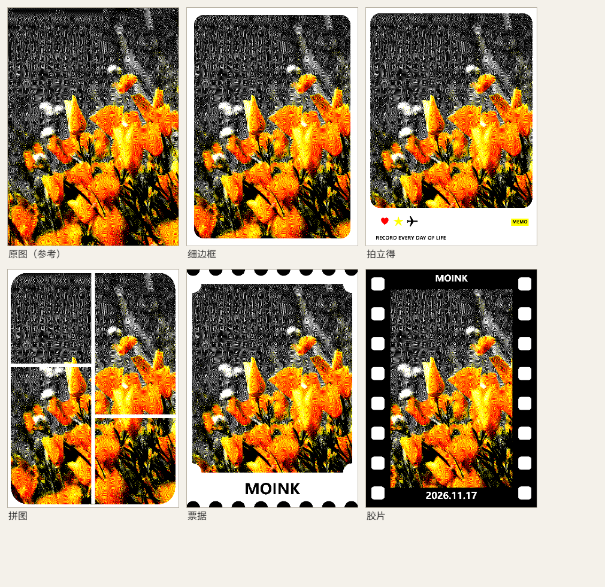
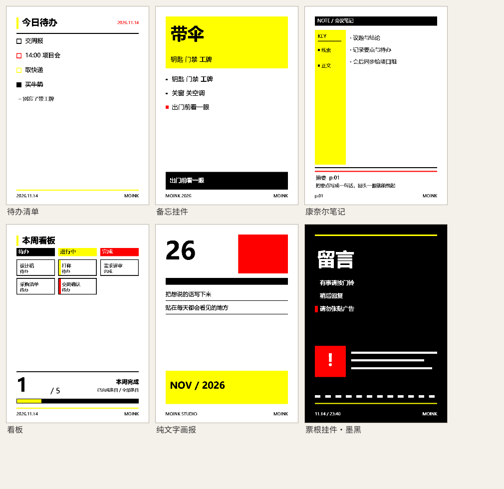
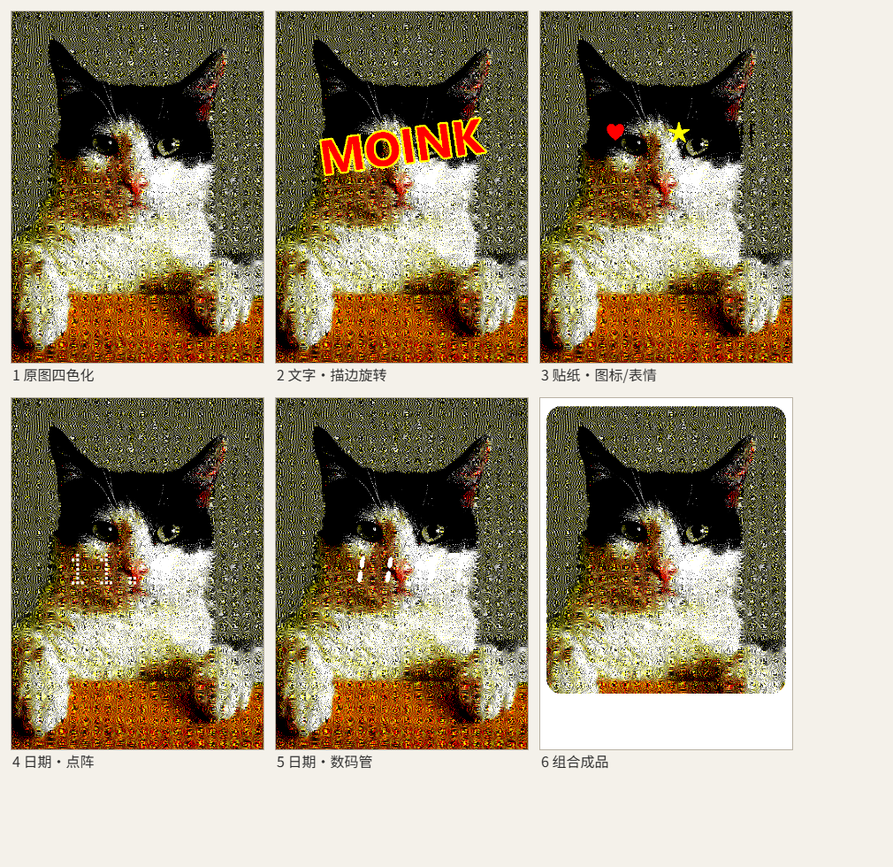
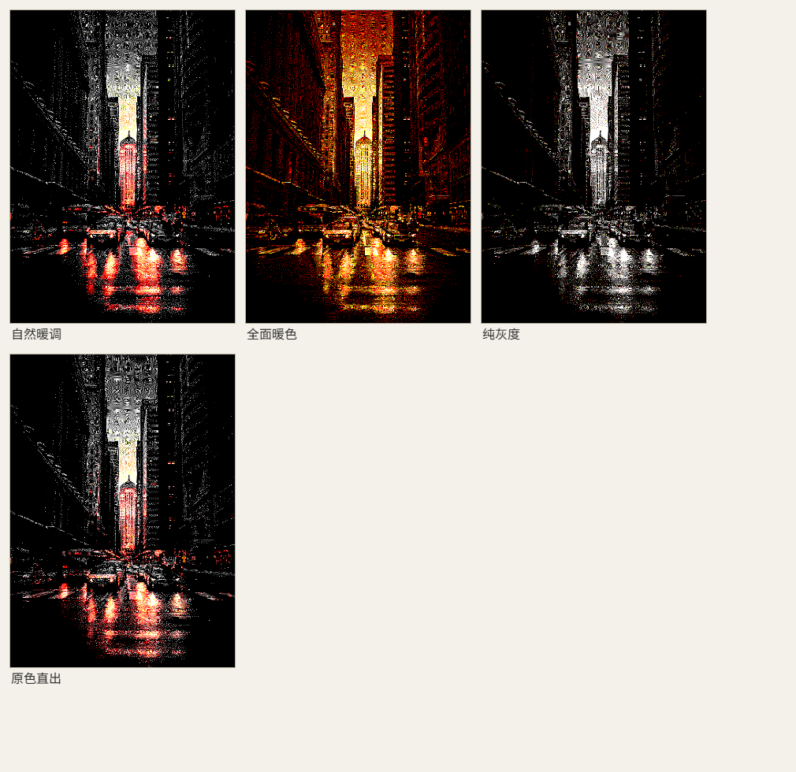

# 墨印 MoInk R1.4.0 更新说明

> 发布日期：2026-11-17　|　接口版本 `api=2`（帧格式未变）　|　版本串：`R1.4.0`（固件 / 控制页 / 文件名一致）

这是 R1.3.7 之后的一次大版本更新：**控制页整体重做、新增便签模式、模板与贴纸全部重写**，并修好了刷机后自锁、重启掉电、反复刷新打不开网页等问题。示例图均为真实照片经设备同款四色算法渲染的效果（非示意图）。

---

## 一、界面重做：手机照片编辑器的手感

原来左右双栏 + 步骤条的桌面式布局已废弃，改为 **顶栏 + 相纸画布 + 底栏四工具**：`构图 · 调色 · 特效 · 保存`。点一项从底部弹出面板，**相纸会自动缩小但始终完整可见**，所见即所得；面板顶部的抓手可以下拉收起。选项一屏一个、不再挤成两字加省略号。

## 二、拍立得 / 模板特效：六种现场绘制边框

「特效 → 模板」提供 6 种边框：**无 / 细边框 / 拍立得 / 拼图 / 票据 / 胶片**。细边框与拍立得照片四角倒 3mm 圆角、拼图靠屏幕边缘四角倒 5mm。

- **拍立得**：下方宽留白自带 红心 ♥ / 黄星 ★ / 黑纸飞机 ✈ + `RECORD EVERY DAY OF LIFE` + 黄色 MEMO 书签，都是**可编辑对象**（换模板自动清除）。
- **胶片**：两侧圆角方形齿孔、上下片名与日期戳。
- **票据**：上 `MOINK` 下日期，四角挖白。

## 三、便签模式：字为主，六种版式 × 六套四色主题

顶栏模式行切到「便签」，底栏随之变成 `内容 / 版式 / 配色 / 保存`。用轻量标记（`#` 标题、`[ ]` 待办、`[!]` 紧急、`[x]` 完成、`-` 笔记、`>` 大字…）一行一块，不想记语法可点「插入」。

- **6 种版式**：待办清单 / 备忘挂件 / 康奈尔笔记 / 看板 / 纯文字画报 / 票根挂件（墨黑）。
- **6 套主题**：纸白 / 黄纸 / 墨黑 / 红标 / 极简 / 风格派，纯黑白黄红、零灰阶渐变，单槽颜色可覆盖。
- 内容跨刷新保留，可直接导出到手机。

## 四、文字 / 贴纸 / 日期

- **文字**：多对象拖动、缩放、旋转、**单独横向拉伸**、描边、底色，画布实时渲染。
- **贴纸**：分「图标（单色，跟四色板换色）/ 表情（系统彩色）/ 上传图片」三类；位图贴纸与照片走同一条调色流水线，不再发灰；默认 emoji 呈现的码位（⚡☀☕✈✉♥ 等）强制文本呈现，**不再混进彩色表情**。
- **日期**：点阵 / 数码管 / 普通三种字形，可设底色与描边、自定义文字。新增日期默认落在**右下角 20px 老照片戳**；点阵按整数像素绘制（放大缩小都是均匀方块点），数码管段厚取整、边缘平滑。

## 五、调色：四种风格预设

「调色 → 风格」提供 自然暖调 / 全面暖色 / 纯灰度 / 原色直出 四种预设，另有 13 项高级参数（亮度 / 对比 / 饱和度 / 锐化 / 暖调 / 四色 / 抖动方式 …）按语义分组。

## 六、稳定性与修复

| 问题 | 修复 |
|------|------|
| 刷机后整合板 / 排线必须一直按住才能开机 | 冷启动把「设置值 + GPIO5 + GPIO1」都作为候选脚，任一读到低即自锁 |
| 网页「保存并重启」后掉电 | 改为「锁存自锁电平 + 深睡 100ms 唤醒」，不再用系统复位 |
| 反复刷新后网页打不开 | 帧数据改流式（删 120KB 静态帧缓冲），运行期可用堆 45KB → 154KB |
| 热点转发 / 上传慢 | 恢复合理的 TCP 窗口与 WiFi 缓冲；自写轻量 HTTP 客户端替代 esp_http_client |
| 运行时 USB 检测误切供电 | 200ms 轮询只保留给 FPC 老排线，其余档位不再轮询 |

## 七、发布与升级口径（重要变化）

- **控制页随固件一起发布**，不再单独提供页面文件；上传入口只接受 `.bin`。
- **web 分区 384KB 并入 OTA 槽**（各 1408KB），`store` 起点不变、已有轮播图不丢。
- 发布件为三件套：`MoInk-FlashKit-R1.4.0.zip`（刷机脚本 + 固件两包 + 说明书）、`moink_R1.4.0_merged.bin`（整包线刷）、`moink_R1.4.0_app.bin`（OTA）。
- **分区表有变，首次升级 / 从更早版本升级必须整包线刷**（写 `0x0`）；之后可正常 OTA。
- 不重置用户设置（屏型 / 休眠 / GPIO / 热点 / 联网）与已有轮播图。
- 已知限制：panic / 看门狗复位仍会断电（需硬件侧解决）。

完整操作见 [操作说明书](操作说明书-R1.4.0.md)，版本流水见 [CHANGELOG](CHANGELOG.md)。
